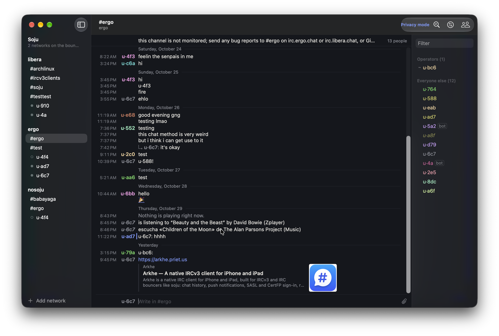

# Keryx

A native IRC client for macOS, written in Swift and SwiftUI, with full IRCv3
support and first-class [soju](https://soju.im) bouncer integration.

Keryx (κῆρυξ) is Greek for *herald*. It reads like a compact, aligned
transcript — time, speaker, text — with each nick in its own colour, joins and
parts folded into a single quiet line, and the conversation you're reading kept
in front of everything else.

**Website and documentation: [keryx.priet.us](https://keryx.priet.us)** —
install, getting started, configuration, every feature and command.



## Install

Keryx needs macOS 15 or later. With [Homebrew](https://brew.sh):

```sh
brew install --cask prietus/tap/keryx
```

Upgrade with `brew upgrade --cask keryx`. To remove it, `brew uninstall --cask keryx`;
add `--zap` to also delete your networks, scrollback and settings (passwords stay
in the Keychain).

Or download the zip from [Releases](https://github.com/prietus/keryx/releases)
and drag `Keryx.app` to Applications. Builds are signed with a Developer ID and
notarized by Apple.

## Reading

- **Compact, aligned transcript**: one line per message, every line timed, text
  always starting in the same column. The speaker column fits the longest nick.
- **Nick colours**: twelve muted hues, stable per person; mentions of you in
  blue. Can be turned off.
- **Quiet presence**: runs of joins, parts, quits and nick changes fold into
  one line ("Enter ana, bob and 3 more. Exit carla."); hide them per channel.
- **Threaded replies** (`+reply`): an answer sits under the line it answers when
  that line is close by, like [irkt](https://github.com/prietus/irkt); further
  away it stays where it arrived, with a one-line quote that jumps to the original.
- **Mentions** (⌘⇧M): every line that named you, on every network, newest
  first; click one to jump to it in its conversation.
- **Unread marker** (⁂) where you left off, synced across devices with
  `draft/read-marker`.
- **Link previews**: cards with site, title, summary and picture; images as
  thumbnails (click to enlarge), animated GIFs, inline video with its first
  frame and running time, and ▶ cards for video pages (YouTube, Vimeo…).
  Pages that just wrap an image (paste sites, your own uploader) show the image.
- **Reactions**, **typing indicators**, **message deletion**, member profiles
  (`draft/metadata-2`: display name, pronouns, avatar).

## Writing

- **Ghost completion**: the rest of the likely word in grey after the caret —
  nicks (recent speakers first), `/commands`, `#channels`, and dictionary words.
  Tab accepts and cycles; → accepts.
- **Spelling** with macOS's own checker; ⌥S fixes the nearest typo. Language
  per conversation (`/lang`, or the sidebar's context menu), or detected.
- **Multiline messages** (`draft/multiline`), long lines split at word
  boundaries, input history with ↑↓.
- **Uploads** by drag and drop or the paperclip: the network's file host
  (`soju.im/FILEHOST`) or your own 0x0-style uploader.
- **`/np`** shares what you're listening to or watching (see below).
- **`/exec`** runs your own scripts and shows (or, with `-o`, sends) their output.

## Everything else

- Multiple networks; a soju account opens one session per bouncer network.
  Each network can run commands on connect (`/mode $nick +x`, …) before joining.
- `/detach` and `/attach` a channel on soju: hidden here, still logged there.
  `/hop` rejoins a channel; `/reconnect` brings back a dropped connection.
- Channel operators: `/ban`, `/kickban` and `/quiet` by host (so a new nick
  doesn't get round them), `+q` or the network's mute extban, ban and quiet
  lists in the channel, half-ops; also from the member list.
- SASL PLAIN, EXTERNAL (CertFP, PKCS#12) and SCRAM-SHA-256, preferred
  automatically; secrets in the Keychain.
- Global history search (⌘⇧F), diacritic-insensitive, over SQLite FTS5.
- Auto-away: away on every network while the screen is locked or after a
  while idle, and back when you return; an `/away` of your own is left alone.
- Command palette (⌘K), notifications for mentions and private messages,
  MONITOR-backed contacts, ignore and dim, privacy mode for screenshots.
- Themes: Paper and Sepia (light), Night and Carbon (dark, true black), or
  Automatic to follow macOS.
- English and Spanish.

## IRCv3

`message-tags`, `server-time`, `batch` (including `netsplit`/`netjoin`),
`labeled-response`, `echo-message`, `cap-notify`, `standard-replies`,
`account-tag`, `account-notify`, `away-notify`, `chghost`, `extended-join`,
`setname`, `invite-notify`, `multi-prefix`, `userhost-in-names`,
`no-implicit-names`, `sts`, `sasl` with `draft/sasl-ir`,
`draft/chathistory` (`LATEST`, `BEFORE`, `AFTER`, `AROUND`, `TARGETS`),
`draft/event-playback`, `draft/multiline`, `draft/read-marker`,
`draft/message-redaction`, `+typing`, `+draft/react`, `+reply`,
`draft/metadata-2`, `MONITOR` with `extended-monitor`, `WHOX`, bot mode,
`CLIENTTAGDENY`, `draft/FILEHOST`, `+draft/channel-context` (a bot's private
answer about a channel shows there, marked as private), `draft/ICON` (the
network's icon in the sidebar), `UTF8ONLY`, `draft/channel-rename`,
`draft/pre-away` (connecting while you're away registers you away).

soju: `soju.im/bouncer-networks`, `soju.im/no-implicit-names`,
`soju.im/FILEHOST`, and ignores, mutes and pins synced through
`soju.im/blocked`, `soju.im/muted` and `soju.im/pinned`.

## Building

Requires macOS 15 or later, Xcode 26 or later and
[XcodeGen](https://github.com/yonaskolb/XcodeGen) (`brew install xcodegen`).

```sh
xcodegen generate
xcodebuild -project Keryx.xcodeproj -scheme Keryx build
xcodebuild -project Keryx.xcodeproj -scheme Keryx test
(cd KeryxProtocol && swift test)
```

The Xcode project is generated from `project.yml` and isn't checked in. That
file carries the author's `DEVELOPMENT_TEAM` and Developer ID identity; set your
own before building to run or distribute.

```
KeryxProtocol/  Swift package: message parsing and encoding, tags, CAP and SASL
                (SCRAM included), STS, ISUPPORT, casemapping. No UI.
Keryx/
  Transport/    Network.framework connection, TLS and CertFP
  Session/      One IRC session: registration, dispatch, history, commands
  Model/        Saved networks, per-network state, scrollback, STS policies
  Services/     Search index, notifications, uploads, link previews, /np, /exec
  Views/        Transcript, composer, sidebar, member list, sheets
KeryxTests/     Session tests against a fake transport, layout and parsing tests
```

In Debug builds, `-KeryxDemo` opens a sample conversation without connecting or
saving anything.

## /np

macOS no longer lets third-party apps read the menu bar's Now Playing, so `/np`
asks players directly: Music and Spotify over AppleScript (only when they're
already open), and any player that speaks this small protocol.

A player posts the distributed notification `im.keryx.NowPlaying` whenever its
track or play state changes, and whenever it sees `im.keryx.NowPlaying.request`.
The payload is a JSON string in the notification's `object` (sandboxed apps
can't send `userInfo`):

```json
{"player": "Zplayer", "title": "…", "artist": "…", "album": "…", "playing": true, "video": false}
```

No `title` means nothing is playing in that player.

## /exec

Keryx is sandboxed, so `/exec` runs only what you put in
`~/Library/Application Scripts/im.keryx.mac/` — the way macOS lets sandboxed apps
run user scripts. Keryx can't write there, so nothing runs that you didn't place
yourself.

- `/exec` lists your scripts and explains how to start.
- `/exec name args…` shows the output to you only.
- `/exec -o name args…` sends it to the conversation (asking first if it's long).

For WeeChat-style `/exec <any command>`, add a script named `sh`:

```sh
D=~/Library/Application\ Scripts/im.keryx.mac
mkdir -p "$D"
printf '#!/bin/sh\ncd "$HOME" || exit 1\nexec /bin/sh -c "$*"\n' > "$D/sh" && chmod +x "$D/sh"
```

Then anything that isn't a script name goes to it: `/exec uptime`,
`/exec -o ls -latr`.

## Shortcuts

| Key | Action |
| --- | --- |
| ⌘K | Go to a conversation, or run a command |
| ⌘F / ⌘⇧F | Find in conversation / search all history |
| ⌘⇧M | Mentions of you |
| ⌘⌥↑ ⌘⌥↓ | Previous / next conversation |
| ⌘⌥⇧↓ | Next unread |
| ⌘⇧W | Close conversation |
| ⌘⌥0 | Show or hide the member list |
| ⌘+ ⌘− | Text size |
| ⌘⇧P | Privacy mode |
| ⌘⌥L | Network protocol log |
| Tab, → | Accept the suggestion (Tab cycles) |
| ⌥S | Fix the nearest typo |
| ↑ ↓ | Input history |
| ⇧↩ | New line |
| Esc | Cancel a reply |

`/help` lists every command.

## Related

Keryx shares its author and its protocol core's lineage with
[Arkhe](https://github.com/prietus/arkhe) (iPhone and iPad),
[Murmur](https://github.com/prietus/murmur) and
[irkt](https://github.com/prietus/irkt) (terminal).

## License

[Apache 2.0](LICENSE) © 2026 Carlos Prieto. The name "Keryx" and the app icon
are not licensed with the code; see [NOTICE](NOTICE).
