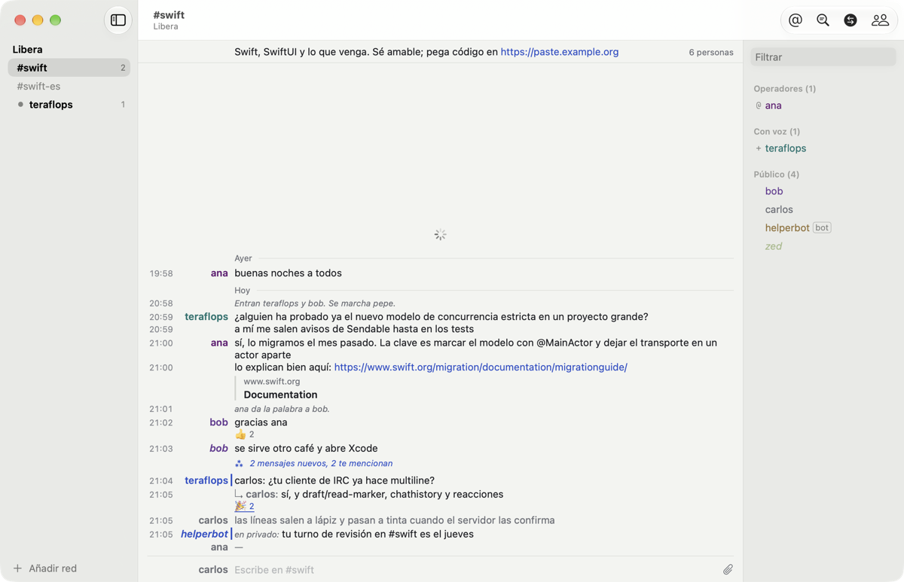
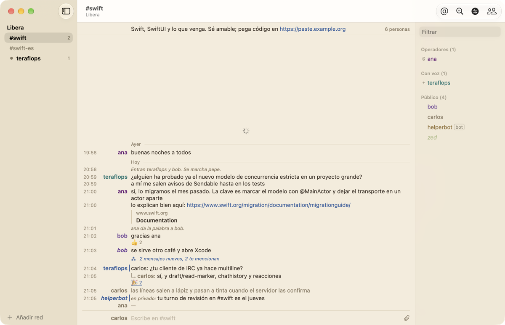
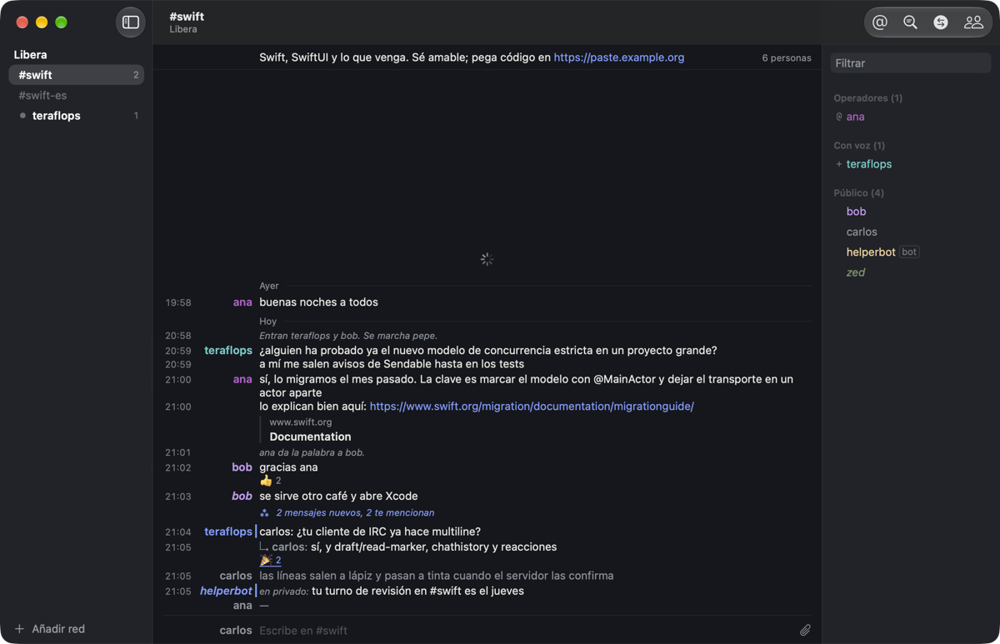
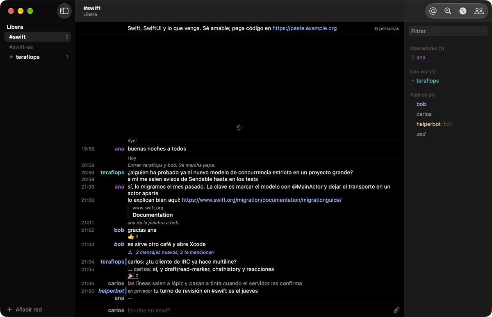

# Themes

Choose one in **Settings › Reading › Theme**. Windows, sheets, menus and system
controls follow it, whatever macOS is set to.

**Paper** — a cool paper with ink nearly black.

{ .shot }

**Sepia** — old book paper and brown ink, easy on the eyes for long reading.

{ .shot }

**Night** — the desk at night: blue-grey, ink like chalk.

{ .shot }

**Carbon** — true black for OLED displays and dark rooms, with a touch more
contrast.

{ .shot }

**Automatic**, the default, follows macOS between Paper and Night.

Every theme has its own versions of the nick colours, the blue pencil for
mentions and links, and the red pencil for errors.
