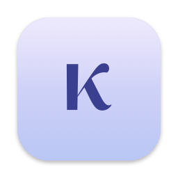
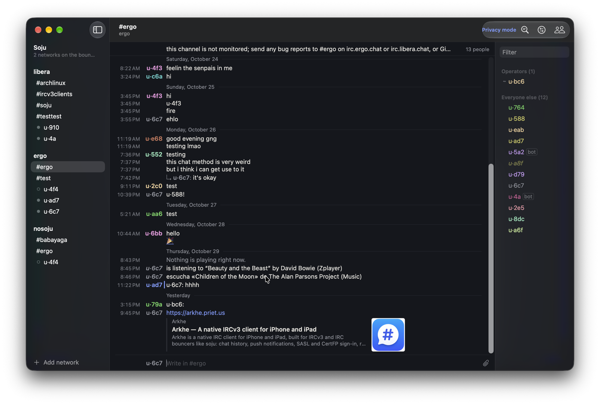

---
hide:
  - navigation
  - toc
---

<div class="hero" markdown>



# Keryx

<p class="tagline">A native IRC client for macOS. Full IRCv3, first-class soju, and a transcript you can actually read.</p>

[Install](install.md){ .md-button .md-button--primary }
[Getting started](getting-started.md){ .md-button }
[GitHub](https://github.com/prietus/keryx){ .md-button }

</div>

{ .shot }

Keryx (κῆρυξ) is Greek for *herald*. It reads like a compact, aligned
transcript — time, speaker, text — with each nick in its own colour, joins and
parts folded into a single quiet line, and the conversation you're reading kept
in front of everything else. It's written in Swift and SwiftUI, sandboxed,
signed and notarized.

```sh
brew install --cask prietus/tap/keryx
```

## Highlights

<div class="grid-2" markdown>

<div markdown>
**A transcript, not a chat app.** One line per message, every line timed, text
always in the same column. Replies nest under what they answer when it's close
by. Joins and parts fold into one line.
</div>

<div markdown>
**IRCv3, all of it that matters.** History, read markers synced across devices,
multiline, reactions, replies, typing, deletion, profiles, STS, SASL with
SCRAM-SHA-256 and CertFP. [The list →](ircv3.md)
</div>

<div markdown>
**Made for soju.** Each bouncer network gets its own place in the sidebar;
history replays exactly what this Mac missed; detach channels, upload files and
sync ignores, mutes and pins through the bouncer. [More →](features/soju.md)
</div>

<div markdown>
**Everything that names you, in one place.** ⌘⇧M lists every mention on every
network. Notifications, a Dock badge, highlight words, and auto-away when you
lock the screen. [More →](features/mentions.md)
</div>

<div markdown>
**Links that show what they are.** Cards with title and picture, image
thumbnails, animated GIFs, inline video with its first frame and running time.
</div>

<div markdown>
**Writing that helps.** Ghost completion for nicks, commands, channels and
words; macOS spelling per conversation; drag-and-drop uploads; `/np` and your
own scripts with `/exec`.
</div>

<div markdown>
**Themes.** Paper and Sepia, Night and Carbon (true black), or Automatic to
follow macOS. [See them →](features/themes.md)
</div>

<div markdown>
**Yours.** Open source under Apache 2.0, no accounts, no telemetry. Passwords
live in the Keychain; scrollback stays on your Mac.
</div>

</div>
